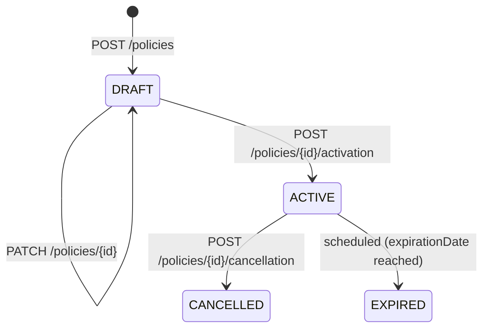

# API Design — Insurance Policy Management API (v1)

## 1. Consumers and capabilities

| Consumer | Trust | Capabilities | Notes |
|---|---|---|---|
| Broker portal (SPA, first-party) | User-delegated (Authorization Code + PKCE) | Create/update draft, activate, cancel, list, read | Interactive; latency-sensitive |
| Broker back-office integrations | Partner (Client Credentials, `private_key_jwt`) | Create, read, list | Batch-like bursts |
| Underwriting services (internal) | Service identity (Client Credentials) | Read, list | Read-only |

## 2. Assumptions and open questions

| ID | Statement | Type |
|---|---|---|
| ASM-001 | Tenant = broker organization, taken from the `org_id` claim of the access token. | Assumption |
| ASM-002 | A policy has at most 50 coverages, defined by the product; coverages are not edited through this API. | Assumption |
| ASM-003 | Only DRAFT policies can be modified; ACTIVE policies change only through cancellation. | Assumption |
| ASM-004 | Premium is calculated upstream and supplied by the caller; this API validates format only. | Assumption |
| Q-001 | Can a cancellation be backdated? Current design: `effectiveDate` ≥ today unless reason = `FRAUD` (to confirm with the business). | Open question |
| Q-002 | Retention period for idempotency keys (design uses 24 h). | Open question |

## 3. Resource model



State transitions with business meaning are **action resources** (`/activation`, `/cancellation`)
instead of `PATCH status`, so each transition has its own scope, validation and audit event.

## 4. Endpoint catalog

| # | Method | Path | operationId | AuthZ | Idempotent | Success | Errors |
|---|---|---|---|---|---|---|---|
| 1 | GET | /policies | listPolicies | `policies:read`; tenant filter | yes | 200 | 400, 401, 403, 429 |
| 2 | POST | /policies | createPolicy | `policies:write`; tenant from token | `Idempotency-Key` | 201 + Location + ETag | 400, 401, 403, 409, 422, 429 |
| 3 | GET | /policies/{policyId} | getPolicy | `policies:read`; owner tenant | yes | 200 + ETag | 401, 404 |
| 4 | PATCH | /policies/{policyId} | updateDraftPolicy | `policies:write`; owner tenant; DRAFT only | `If-Match` | 200 | 400, 401, 404, 409, 412, 422, 428 |
| 5 | POST | /policies/{policyId}/activation | activatePolicy | `policies:write`; owner tenant | `Idempotency-Key` | 200 | 401, 404, 409, 412, 422 |
| 6 | POST | /policies/{policyId}/cancellation | cancelPolicy | `policies:cancel`; owner tenant | `Idempotency-Key` | 200 | 400, 401, 403, 404, 409, 422 |
| 7 | GET | /policies/{policyId}/coverages | listPolicyCoverages | `policies:read`; owner tenant | yes | 200 | 401, 404 |

## 5. Request/response examples

`POST /v1/policies`

```http
POST /v1/policies HTTP/1.1
Authorization: Bearer <access-token>
Idempotency-Key: 0d1f7a52-3a0b-4b9e-9a3f-1e2d0c8b7a65
Content-Type: application/json

{ "productCode": "MOTOR-STD", "holder": { "customerId": "CUS-000123" },
  "effectiveDate": "2026-12-01", "premium": { "amount": "540.00", "currency": "EUR" } }
```

```http
HTTP/1.1 201 Created
Location: /v1/policies/5b7c1e8e-4f0a-4a51-9c11-2f3b9d6e7a10
ETag: "v1"
Content-Type: application/json

{ "id": "5b7c1e8e-4f0a-4a51-9c11-2f3b9d6e7a10", "policyNumber": "POL-2026-000981",
  "productCode": "MOTOR-STD", "status": "DRAFT", "holder": { "customerId": "CUS-000123" },
  "effectiveDate": "2026-12-01", "expirationDate": null,
  "premium": { "amount": "540.00", "currency": "EUR" }, "cancellation": null,
  "createdAt": "2026-11-13T10:15:30Z", "updatedAt": "2026-11-13T10:15:30Z" }
```

## 6. Authentication and authorization model

- OAuth 2.0: Authorization Code + PKCE for the portal; Client Credentials (`private_key_jwt`) for
  partners and internal services. JWT access tokens validated for signature (RS256/ES256 pinned),
  `iss`, `aud`, `exp`, `typ=at+jwt`.
- Scopes: `policies:read`, `policies:write`, `policies:cancel` (cancellation separated because it has
  financial impact).
- **Object level:** every query is scoped by `org_id` from the token
  (`WHERE id = :id AND org_id = :org`). Not found and other-tenant both return `404`.
- **Property level:** `id`, `policyNumber`, `status`, timestamps are read-only and absent from
  request schemas (`additionalProperties: false` rejects them).

## 7. Error catalog (RFC 9457)

| `type` (suffix of `https://api.example-insurer.com/problems/`) | Status | When | Retryable | Client action |
|---|---|---|---|---|
| `validation-error` | 400 | Malformed JSON, schema violation | no | Fix request (see `errors[].pointer`) |
| `unauthenticated` | 401 | Missing/invalid/expired token | after re-auth | Obtain a new token |
| `insufficient-scope` | 403 | Scope missing | no | Request the scope |
| `not-found` | 404 | Unknown policy or other organization | no | Check ID |
| `invalid-state-transition` | 409 | e.g. activate a CANCELLED policy | no | Read current state |
| `idempotency-key-in-use` | 409 | Same key still processing | yes (backoff) | Retry later |
| `stale-etag` | 412 | `If-Match` mismatch | after re-read | GET, merge, retry |
| `business-rule-violation` | 422 | e.g. effectiveDate in the past | no | Fix data |
| `idempotency-key-reused` | 422 | Same key, different payload | no | Use a new key |
| `precondition-required` | 428 | `If-Match` missing | no | Send `If-Match` |
| `rate-limited` | 429 | Quota exceeded | yes (`Retry-After`) | Back off |

## 8. ADR-001: Model state transitions as action resources

- **Status:** Proposed
- **Context:** Activation and cancellation have distinct permissions, validations and audit needs
  (Verified from requirements). A generic `PATCH {status}` would mix them.
- **Alternatives:** (A) `PATCH /policies/{id}` with `status`; (B) action sub-resources
  `POST /policies/{id}/activation|cancellation`; (C) generic `POST /policies/{id}/transitions`.
- **Decision:** B — explicit operations map 1:1 to scopes, request schemas and audit events; easiest
  for consumers and gateways to authorize. Trade-off: more endpoints to document.
- **Validation criteria:** each transition has its own contract tests; invalid transitions return
  `409 invalid-state-transition`; audit log contains one event per transition.

## 9. Security recommendations

1. Rate limit per client and per organization (stricter on POST).
2. Audit log for create/activate/cancel with actor, org, policy ID and outcome.
3. `Cache-Control: no-store` on policy responses (PII).
4. Cross-tenant regression tests in CI (see test scenarios).

## 10. Test scenarios (excerpt)

| ID | Scenario | Expected |
|---|---|---|
| TC-FUN-001 | Create draft with valid payload | 201, `Location`, `ETag`, `status=DRAFT`, body matches schema |
| TC-FUN-002 | Retry create with same `Idempotency-Key` and payload | Same 201 body, only one policy persisted |
| TC-FUN-003 | Same key, different payload | 422 `idempotency-key-reused` |
| TC-FUN-004 | Activate CANCELLED policy | 409 `invalid-state-transition`, state unchanged |
| TC-CON-001 | Create with `status: ACTIVE` in body | 400 (unknown property rejected), nothing persisted |
| TC-SEC-001 | Org B token reads org A policy | 404 Problem Details, no policy data in body |
| TC-SEC-002 | `policies:write` token cancels | 403 `insufficient-scope` |
| TC-SEC-003 | Token with wrong `aud` | 401 with `WWW-Authenticate` |
| TC-RES-001 | PATCH with stale ETag | 412, policy unchanged |
| TC-BND-001 | `limit=101` | 400 |

Automation examples: see `examples/api-testing-example/`.
