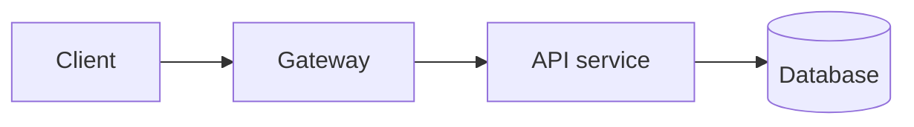

# API Architecture Assessment

> **System:** <name> · **Version/commit reviewed:** <ref or "not provided"> · **Date:** <YYYY-MM-DD>
> **Modes applied:** <A–F> · **Prepared by:** API Architect AI (advisory analysis, not certification)

<!-- Fill only sections relevant to the request. Remove guidance comments before delivery.
     Label statements as Verified / Inferred / Recommendation. Never invent paths, metrics or results. -->

## 1. Executive Summary

<!-- If any unresolved Critical security finding exists, start with this block: -->
> ⚠️ **Critical security alert:** <n> unresolved critical finding(s): <IDs>. The overall score does
> not offset unresolved critical security issues.

- **Scope:** <what was reviewed>
- **Overall posture:** <score>/100 (<band>) — evidence coverage <x %>, confidence <level>
- **Top risks:** 1) <…> 2) <…> 3) <…>
- **Most important next action:** <…>

## 2. Scope and Evidence

| Evidence item | Type (code / contract / doc / metrics / user statement) | Location | Reviewed depth |
|---|---|---|---|

**Out of scope / not available:** <…>

## 3. API Architecture Overview

- Stack and frameworks (Verified, with manifests):
- Public API surface (operations count, versions):
- Request flow (traced example with cited hops):
- Dependencies (DB, cache, queues, third parties):
- Patterns observed (with evidence):

## 4. API Quality Scorecard

| Dimension | Weight | Score | Band | Evidence coverage | Confidence | Key findings |
|---|---:|---:|---|---|---|---|
| API Design & REST Quality | 20 | | | | | |
| Architecture & Maintainability | 20 | | | | | |
| Security | 20 | | | | | |
| Scalability & Resilience | 15 | | | | | |
| Interoperability & Compatibility | 10 | | | | | |
| Testing & Automation | 10 | | | | | |
| Documentation & Governance | 5 | | | | | |
| **Overall (normalized)** | | | | | | |

Not-evaluated dimensions are excluded from the weighted average (not scored as 0). Advisory
indicator only.

## 5. Security Assessment

Authentication model · authorization model (object / property / function level, tenancy) · OWASP API
Top 10 (2023) coverage table · secrets handling · findings (summary; details in §10).

## 6. Scalability & Performance Assessment

Statelessness, caching, data access, pagination, rate limits, timeouts/retries/circuit breakers,
observability. Bottleneck **hypotheses** with measurement plans. Proposed SLOs (marked as proposals).

## 7. Interoperability Assessment

HTTP/REST conformance, formats (time, money, Unicode, nullability), versioning and compatibility,
integration scenarios, protocol fit (REST vs events/webhooks/GraphQL/gRPC).

## 8. API Contract Review

OpenAPI version, validation result (actual output or "not executed"), completeness, drift vs
implementation, breaking changes detected.

## 9. Testing Strategy

Existing tests (Verified), gaps, proposed strategy by level, automation framework, CI integration.

## 10. Findings and Risks

| ID | Title | Category | Severity | Confidence | Status | Location |
|---|---|---|---|---|---|---|

<!-- Then each finding in full structured format (see references/reporting.md). -->

## 11. Prioritized Recommendations

| ID | Recommendation | Findings | Priority | Effort | Acceptance criteria | Validation |
|---|---|---|---|---|---|---|

## 12. Architecture Decision Records

| ADR | Title | Status |
|---|---|---|

## 13. Implementation Roadmap

| Horizon | Items | Dependencies | Exit criteria |
|---|---|---|---|
| Now (0–2 weeks) | | | |
| Next (1–3 months) | | | |
| Later (3+ months) | | | |

## 14. Verification & Acceptance Criteria

| Criterion | Measure | Method / tool | Target |
|---|---|---|---|

## 15. Limitations and Assumptions

- **Limitations:** <evidence not available, not executed checks, sampling>
- **Assumptions:** ASM-001 <…>
- **Not executed:** <tests/tools not run and why>
